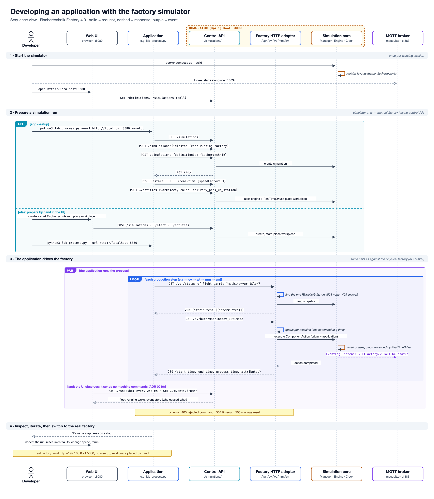
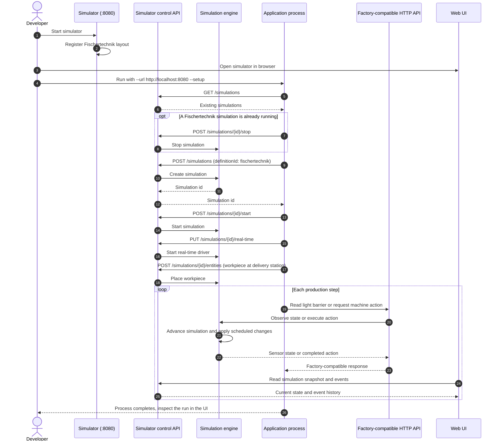

# Applications

Example applications, one folder per layout. They show how an application drives a layout and that the same application runs against the simulator and the physical layout.

| Layout | Application | Talks to the layout through |
|---|---|---|
| Demo line | [demo](demo/README.md) | the simulator's control API (the demo layout has no hardware) |
| Fischertechnik Factory 4.0 | [fischertechnik](fischertechnik/README.md) | the factory's own HTTP API (ADR 0009) |

## Developing an application with the factory simulator

Start the simulator, then run the application against its factory-compatible HTTP API. For the Fischertechnik example, `--setup` uses the simulator's separate control API to create and prepare a simulation, then the process drives it through the same HTTP API used by the physical factory. The Web UI observes the run; it does not issue machine commands.

Vector version: [application-development-sequence.svg](../docs/diagrams/application-development-sequence.svg).

Without `--setup`, prepare the workpiece in the UI before running the process. Against the physical factory, use its URL and put the workpiece in by hand; the application still sends its machine commands through the factory-compatible API.
