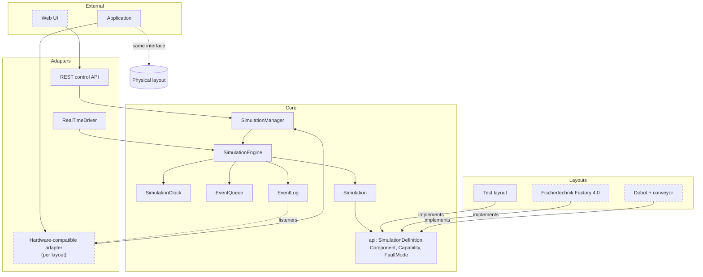
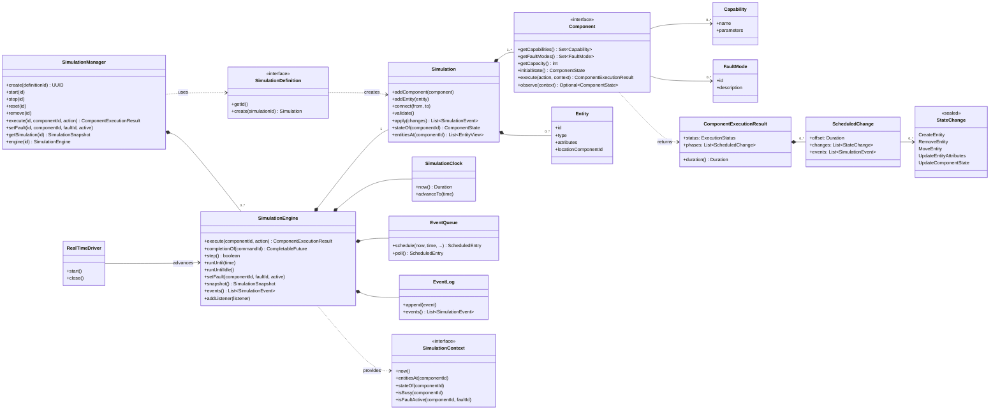
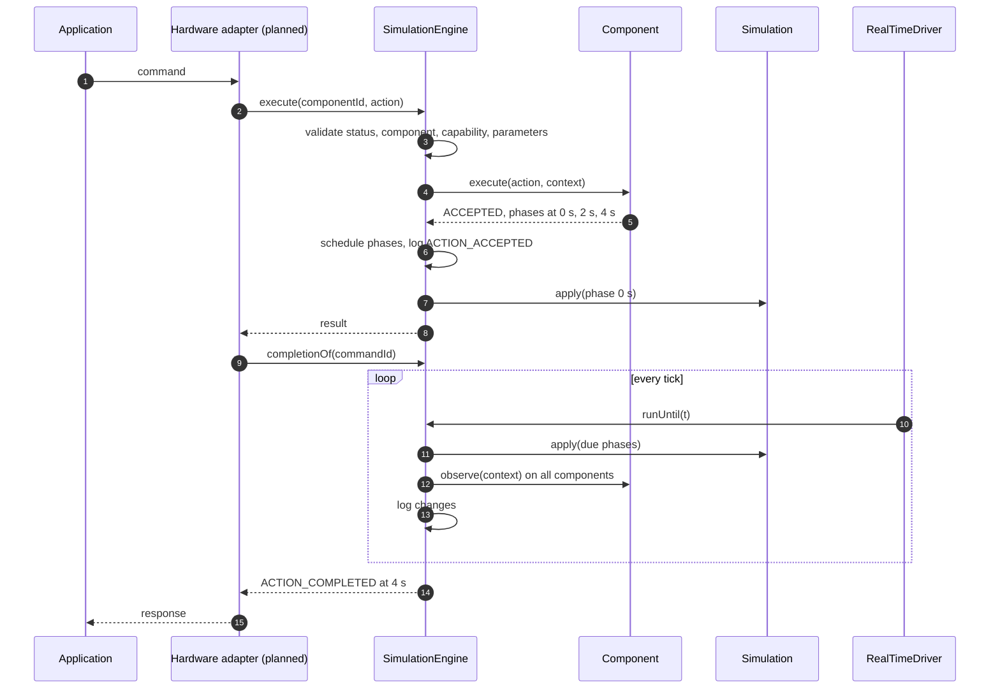
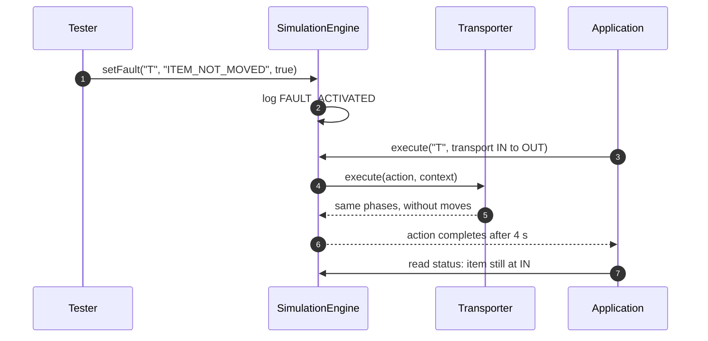
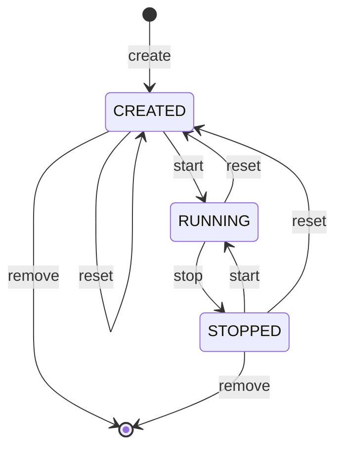

# Architecture

Dashed elements are planned, all others are implemented. Decisions: [ADRs](adr/README.md). Class contracts: [SIMULATION_CLASS_ARCHITECTURE.md](SIMULATION_CLASS_ARCHITECTURE.md).

## 1. Building blocks

## 2. Core classes

## 3. Timed action

Example: transport with phases at 0 s (busy), 2 s (pick up) and 4 s (drop off, idle). The hardware adapter is planned; in tests, `step()` or `runUntil()` replaces the `RealTimeDriver`.

## 4. Fault

## 5. Lifecycle

Only `RUNNING` accepts commands and advances time. `stop` keeps scheduled phases. `reset` rebuilds the simulation from its definition with the same id.
