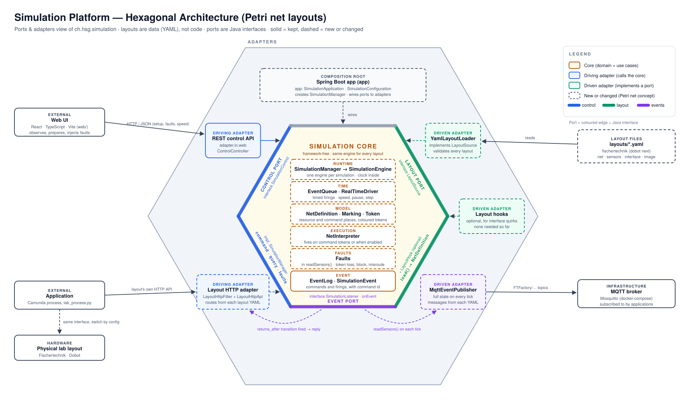
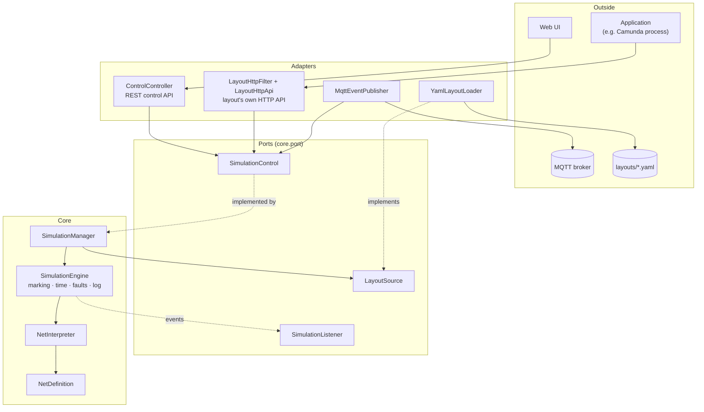
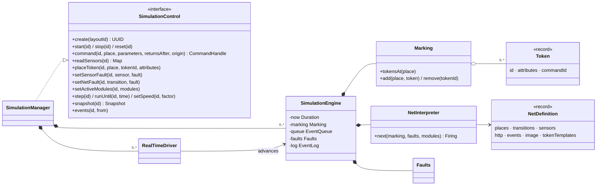
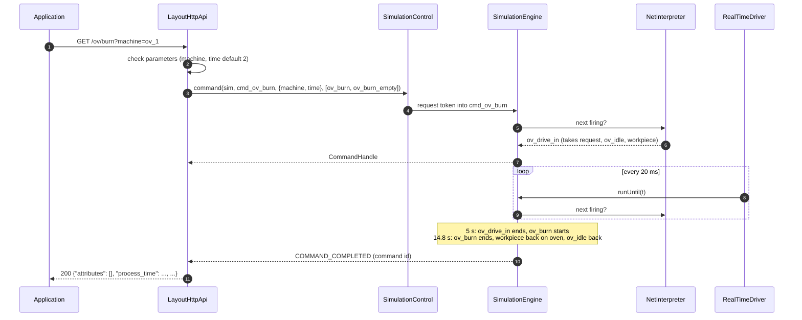
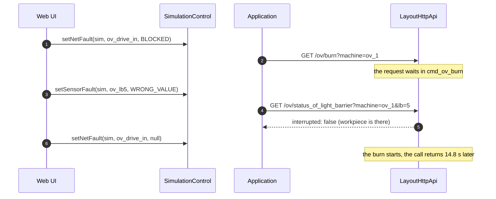
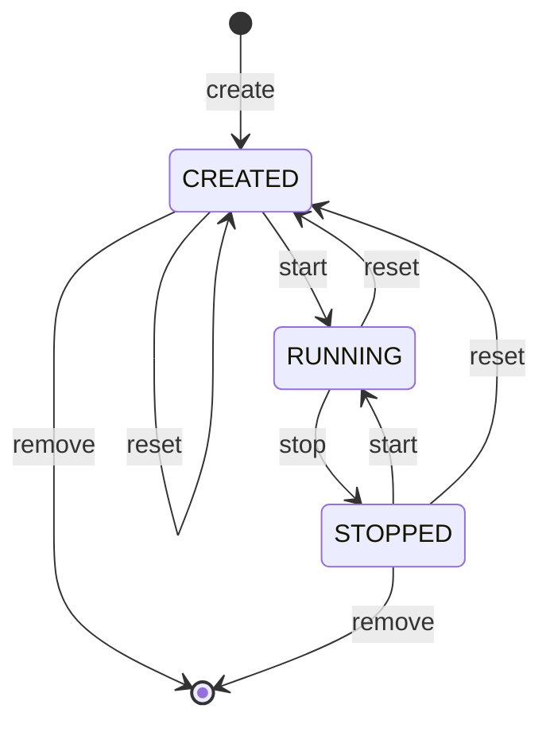

# Architecture

Decisions: [ADRs](adr/README.md). Layout format: [layouts/layout-format.md](layouts/layout-format.md).

## Hexagonal view

Vector version: [hexagonal-architecture.svg](diagrams/hexagonal-architecture.svg). Classes: [class-diagram.svg](diagrams/class-diagram.svg).

## 1. Building blocks

## 2. Core classes

## 3. A command through the layout's own interface

Example: `GET /ov/burn?machine=ov_1` with the burn taking 5 s + 2 × 2.4 s.

A second burn sent meanwhile waits as a token in `cmd_ov_burn` until `ov_idle` has its token back, like the factory's queue.

## 4. A fault

## 5. Lifecycle

Only `RUNNING` accepts commands and moves time. `stop` keeps firings in progress. `reset` returns to the initial marking at time zero, same id, no faults, empty trace.
